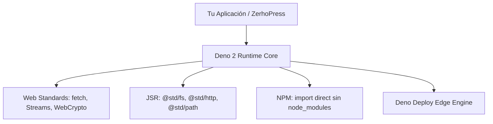

## Runtime Nativo Deno 2

Deno 2 simplifica el desarrollo web moderno unificando la compatibilidad completa con el ecosistema
**npm**, la biblioteca estándar oficial **JSR (@std)** y las especificaciones de **Web Standards**.



---

## Servidor HTTP Nativo: `Deno.serve`

La API estándar para manejar tráfico HTTP en Deno 2 no requiere bibliotecas externas y se basa
directamente en los objetos estándar `Request` y `Response` de la Web.

```ts [servidor-basico.ts]
Deno.serve({ port: 8000 }, (request: Request) => {
  const url = new URL(request.url);

  if (url.pathname === "/saludo") {
    return Response.json({ mensaje: "¡Hola desde Deno 2!" });
  }

  return new Response("Bienvenido a ZerhoPress Edge", { status: 200 });
});
```

### Características de `Deno.serve`

- **Alto Rendimiento**: Implementado internamente en Rust con Hyper.
- **Soporte de WebSockets**: Actualización directa con `Deno.upgradeWebSocket(req)`.
- **TLS Automático**: Soporte directo para certificados HTTPS.

---

## Compatibilidad con NPM

En Deno 2 puedes importar cualquier paquete de npm directamente usando el especificador `npm:` sin
necesidad de un archivo `package.json` ni una carpeta `node_modules` local:

```ts [npm-import.ts]
import { marked } from "npm:marked@15";
import chalk from "npm:chalk@5";

console.log(chalk.green("Marked cargado con éxito"));
```

---

## Biblioteca Estándar Oficial (@std)

La biblioteca estándar de Deno está publicada en [JSR](https://jsr.io/@std) y ofrece módulos seguros
y auditados:

```ts [std-ejemplo.ts]
import { join } from "jsr:@std/path";
import { exists } from "jsr:@std/fs";
import { parse } from "jsr:@std/yaml";

const existe = await exists("./deno.json");
console.log("¿Existe deno.json?", existe);
```

::: tip GESTIÓN EFICIENTE DE DEPENDENCIAS Al usar ZerhoPress en Deno Deploy, todas las dependencias
se descargan y verifican criptográficamente en tiempo de arranque, garantizando compilaciones
inmutables y reproducibles. :::
