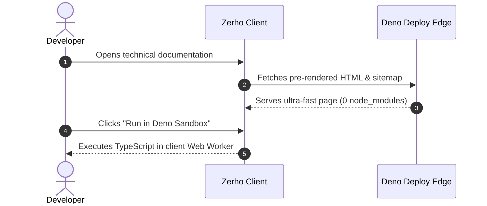

# Markdown Superpowers

Discover the rich authoring capabilities available in Zerho for technical documentation.

---

## Polyglot Synchronized Code Groups (`::: code-group`)

Group multi-platform installation commands or code examples with automatic client-side
synchronization:

::: code-group

```bash [Deno]
deno add jsr:@zerho/zerho
```

```bash [npm]
npx jsr add @zerho/zerho
```

```bash [pnpm]
pnpm dlx jsr add @zerho/zerho
```

```bash [bun]
bunx jsr add @zerho/zerho
```

:::

::: tip GLOBAL SELECTION SYNC

When the user picks **pnpm** or **Deno**, Zerho remembers this preference in `localStorage` and
updates every code group across the documentation instantly.

:::

---

## VitePress Callouts & GitHub Alerts

Zerho supports standard callout containers:

::: info INFORMATION

Electric cyan container for general notes, context, or explanations.

:::

::: tip PRO TIP

You can embed inline code, **bold text**, and links inside any callout container.

:::

::: warning WARNING

Modifying runtime flags can change module resolution behavior in Deno 2.

:::

::: danger DANGER

Never expose sensitive credentials or private API keys in client-side code.

:::

GitHub flavored alerts are also automatically mapped:

> [!NOTE]
> This alert was written using standard GitHub `> [!NOTE]` syntax.

> [!TIP]
> Both `> [!TIP]` and `> [!IMPORTANT]` are supported interchangeably.

---

## Native Mermaid Architecture Diagrams

Render clean flowcharts and sequence diagrams without extra plugins:



---

## Declarative UI Components (`steps`, `tabs`, `cards`, `file-tree`)

Build rich interactive layouts using pure Markdown containers:

::: steps

### Scaffold your docs

Run `deno run -A jsr:@zerho/core/init` to bootstrap your project in seconds.

### Configure & theme

Customize brand colors, auto-sidebars, and plugins in `zerho.config.ts`.

:::

::: cards

- ⚡ **Sub-100ms Builds** | Native Deno 2 SSG engine with zero `node_modules`. |
  /en/guide/getting-started
- 🔌 **OpenAPI 3.1 Explorer** | Automatic `$ref` resolution and 5-language client snippets. |
  /api/openapi

:::

---

## Mathematical Formulas (LaTeX / KaTeX)

Write inline equations like $f(x) = x^2 + 1$ or display math blocks rendered automatically via
KaTeX:

$$
\nabla \times \mathbf{E} = -\frac{\partial \mathbf{B}}{\partial t}
$$
