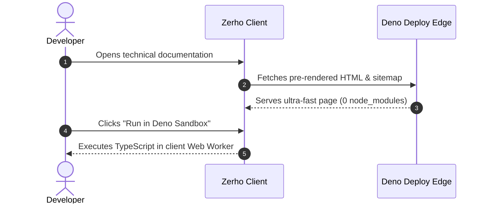

# Markdown Superpowers

Discover the rich authoring capabilities available in Zerho for technical documentation.

---

## Polyglot Synchronized Code Groups (`::: code-group`)

Group multi-platform installation commands or code examples with automatic client-side
synchronization:

::: code-group

```bash [Deno]
deno add jsr:@zerho/zerho
```

```bash [npm]
npx jsr add @zerho/zerho
```

```bash [pnpm]
pnpm dlx jsr add @zerho/zerho
```

```bash [bun]
bunx jsr add @zerho/zerho
```

:::

::: tip GLOBAL SELECTION SYNC When the user picks **pnpm** or **Deno**, Zerho remembers this
preference in `localStorage` and updates every code group across the documentation instantly. :::

---

## VitePress Callouts & GitHub Alerts

Zerho supports standard callout containers:

::: info INFORMATION Electric cyan container for general notes, context, or explanations. :::

::: tip PRO TIP You can embed inline code, **bold text**, and links inside any callout container.
:::

::: warning WARNING Modifying runtime flags can change module resolution behavior in Deno 2. :::

::: danger DANGER Never expose sensitive credentials or private API keys in client-side code. :::

GitHub flavored alerts are also automatically mapped:

> [!NOTE]
> This alert was written using standard GitHub `> [!NOTE]` syntax.

> [!TIP]
> Both `> [!TIP]` and `> [!IMPORTANT]` are supported interchangeably.

---

## Native Mermaid Architecture Diagrams

Render clean flowcharts and sequence diagrams without extra plugins:


