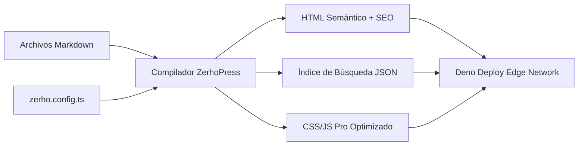

## ¿Qué es ZerhoPress?

**ZerhoPress** es un generador de sitios estáticos (SSG) y de documentación técnica de alta gama construido específicamente para el ecosistema **Deno 2** y optimizado para distribución global instantánea en **Deno Deploy**.

Inspirado en la ergonomía de VitePress, ZerhoPress eleva la experiencia al **Nivel Pro**:

1. **Nativo para Deno 2**: Cero necesidad de Node.js, `npm` ni paquetes duplicados de 400MB.
2. **Playground Interactivo Integrado**: Ejecuta código TypeScript/JavaScript directamente dentro de las páginas de documentación sin salir al navegador.
3. **Búsqueda Instantánea Cmd+K**: Búsqueda client-side ultrarrápida indexada en el build.
4. **Resaltado de Sintaxis Pro**: Pestañas de archivos (ej. `[main.ts]`), badges de lenguaje y botón de copiado con feedback háptico.
5. **Diagramas Mermaid Nativos**: Renderizado automático de flujos y arquitecturas.

---

## Inicio Rápido

Para iniciar un proyecto con ZerhoPress en tu equipo, solo necesitas tener [Deno](https://deno.com) instalado:

```bash [Terminal]
# 1. Iniciar el servidor de desarrollo con Live-Reload
deno task dev

# 2. Compilar el sitio estático para producción
deno task build

# 3. Previsualizar la versión de producción
deno task serve
```

::: tip RECARGA EN VIVO (HMR)
El comando `deno task dev` incluye un servidor WebSocket integrado que detecta automáticamente cualquier cambio en los archivos Markdown o configuraciones y recarga el navegador al instante.
:::

---

## Prueba Interactiva en Vivo

A continuación puedes probar un bloque ejecutable en tiempo real. Pulsa el botón **Ejecutar en Deno** para ver el resultado procesado en milisegundos en el sandbox:

```ts run [demo.ts]
interface RuntimeInfo {
  name: string;
  version: string;
  features: string[];
}

const info: RuntimeInfo = {
  name: "ZerhoPress Sandbox",
  version: Deno.version.deno,
  features: ["Web Workers", "WebCrypto", "Streams", "Edge Caching"]
};

console.log("⚡ Runtime inicializado con éxito:");
console.log(JSON.stringify(info, null, 2));
console.log("Estado de la región:", Deno.env.get("REGION"));
```

---

## Estructura de Directorios

La estructura recomendada para un proyecto ZerhoPress es limpia y modular:

```bash
mi-proyecto/
├── deno.json           # Tareas y dependencias estándar de Deno
├── zerho.config.ts     # Configuración de navegación, sidebar y metadatos
├── main.ts             # Servidor Edge nativo para Deno Deploy
├── docs/               # Archivos Markdown de tu documentación
│   ├── index.md        # Landing page con layout 'home'
│   ├── guide/          # Guías de usuario y tutoriales
│   ├── api/            # Referencias técnicas y de API
│   └── playground/     # Entorno interactivo en vivo
└── dist/               # Salida estática compilada (HTML, CSS, JS)
```

---

## Arquitectura de Compilación

ZerhoPress sigue un pipeline de compilación directo y sin sobrecarga:



::: info DESPLIEGUE EN EL EDGE
Al hacer push a GitHub, tu documentación se distribuye automáticamente en la red perimetral de Deno Deploy con latencias de respuesta inferiores a 10 milisegundos.
:::
