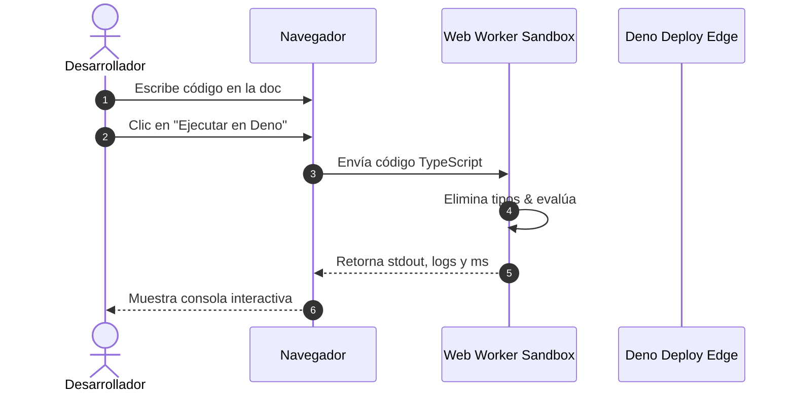

## Callouts y Contenedores Personalizados

Zerho soporta contenedores estilizados estilo VitePress para resaltar notas, sugerencias,
precauciones y detalles desplegables:

::: info INFORMACIÓN Este es un bloque de información general con tono azul eléctrico. Ideal para
contexto adicional o notas explicativas. :::

::: tip CONSEJO PRO Puedes usar Markdown dentro de los callouts, como **negritas**, _cursivas_ o
`código en línea`. :::

::: warning ADVERTENCIA Ten en cuenta que modificar ciertas variables de entorno puede alterar el
comportamiento del runtime de Deno. :::

::: danger PELIGRO No expongas credenciales privadas ni claves de API en el código estático del
cliente. :::

::: details Haz clic para ver detalles avanzados Aquí puedes colocar contenido colapsable que no
sobrecargue la lectura inicial del usuario, como registros de depuración o tablas extensas. :::

---

## Compatibilidad con Alertas de GitHub

Zerho también procesa automáticamente la sintaxis estándar de alertas de GitHub:

> [!NOTE]
> Esta alerta fue escrita utilizando la sintaxis estándar `> [!NOTE]` de GitHub Flavored Markdown.

> [!TIP]
> También puedes utilizar `> [!TIP]` y `> [!IMPORTANT]` de manera intercambiable.

---

## Bloques de Código con Pestaña de Archivo

Al documentar código de producción, puedes especificar el nombre del archivo entre corchetes
`[archivo.ext]`:

```ts [server.ts]
import { serve } from "jsr:@std/http";

serve((req) => {
  return new Response("¡Hola desde Zerho en Deno 2!");
}, { port: 8000 });
```

---

## Bloques Ejecutables Interactivos

Si agregas la palabra clave `run` a un bloque de código (por ejemplo: `ts run`), Zerho lo transforma
en un **Sandbox Interactivo de Deno** con botón de ejecución y consola en vivo:

```ts run [calculo-crypto.ts]
const datos = "Mensaje secreto para Deno";
console.log("Calculando resumen criptográfico...");

const encoder = new TextEncoder();
const digest = await crypto.subtle.digest("SHA-256", encoder.encode(datos));
const hash = Array.from(new Uint8Array(digest)).map((b) => b.toString(16).padStart(2, "0")).join(
  "",
);

console.log("Texto original:", datos);
console.log("Hash SHA-256 :", hash);
```

---

## Diagramas Mermaid Nativos

Escribe diagramas en texto plano utilizando la sintaxis `mermaid`. Zerho los procesa e interactúa
dinámicamente:



---

## Tablas de Comparación

| Característica           |       VitePress Estándar       |             Zerho Pro             |
| :----------------------- | :----------------------------: | :-------------------------------: |
| **Runtime Base**         |         Node.js / npm          |         **Deno 2 Nativo**         |
| **Playground en Vivo**   |      ❌ Requiere plugins       |      **✅ Nativo de Serie**       |
| **Despliegue Edge**      |      Configuración manual      |     **✅ 1 Clic Deno Deploy**     |
| **Búsqueda Instantánea** | Algolia externo / local básico | **✅ Minisearch Cmd+K integrado** |
| **Diagramas Mermaid**    |  Requiere dependencias extra   |     **✅ Incluido de serie**      |
| **Tiempos de Arranque**  |             ~2.5s              |            **~180ms**             |
